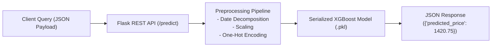
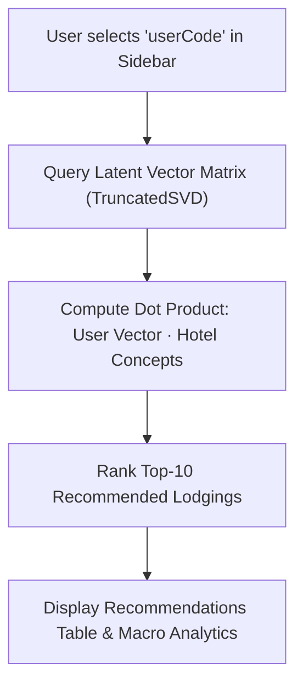
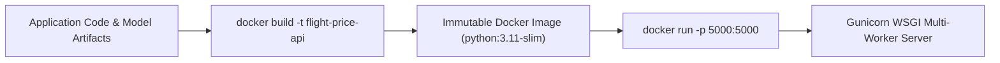
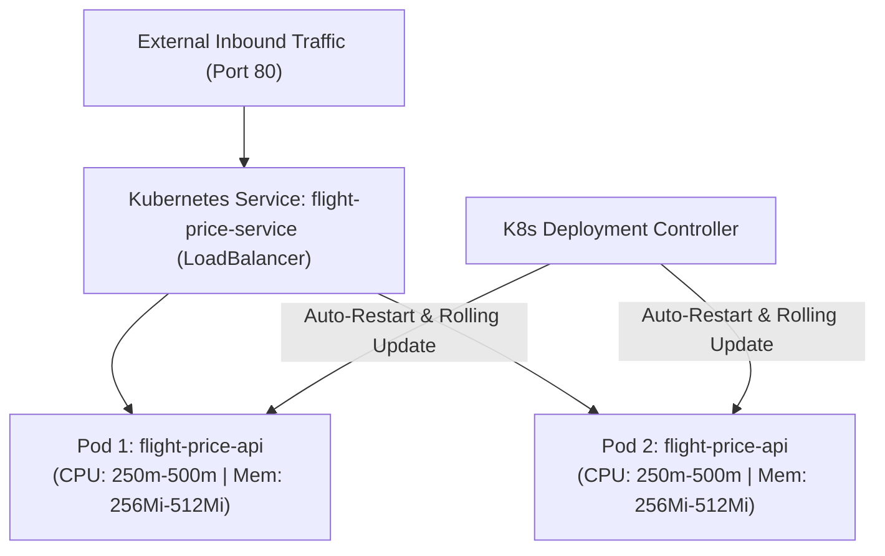
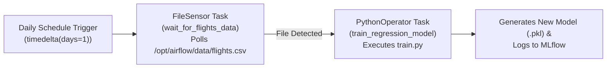
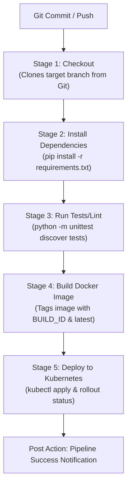
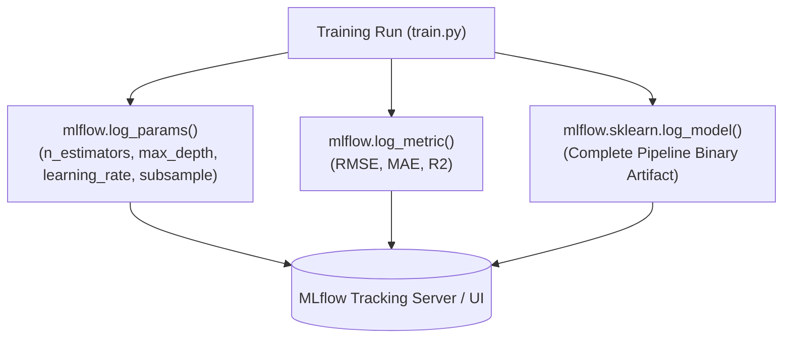

# Voyage Analytics: End-to-End MLOps Workflow Documentation

> **Note for Submission**: Copy and paste the contents of this document directly into a **Google Doc**. Insert your actual application screenshots into the marked placeholders (`[INSERT SCREENSHOT ...]`) as instructed. Per project guidelines, no tool installation commands are included; this document focuses strictly on the production workflow, architecture, implementation, and verification across all 7 MLOps stages.

---

## Executive Summary

**Voyage Analytics** is an enterprise Machine Learning Operations (MLOps) platform built for the travel and tourism industry. The core predictive engine utilizes an Extreme Gradient Boosting regression model (`XGBRegressor`) trained on 271,890 flight transaction records to predict dynamic flight prices in real-time. 

To bridge the gap between experimental model training and production reliability, this document details the complete end-to-end operational workflow across seven core MLOps stages:
1. **REST API Serving (Flask)** — Low-latency real-time inference and web interaction.
2. **Interactive Analytics Application (Streamlit)** — Business intelligence and recommendation interface.
3. **Containerization (Docker)** — Standardized runtime encapsulation with Gunicorn WSGI.
4. **Container Orchestration (Kubernetes)** — High availability, multi-replica scaling, and load balancing.
5. **Workflow Automation & Scheduling (Apache Airflow)** — Event-driven retraining DAGs triggered by new data arrival.
6. **Continuous Integration & Continuous Deployment (Jenkins CI/CD)** — Automated testing, image building, and rolling cluster deployments.
7. **Experiment Tracking & Model Governance (MLflow)** — Full parameter auditing, metric benchmarking, and model lineage tracking.

---

## Stage 1: REST API Serving (Flask)

### 1. Workflow & Architecture
The flight price prediction model is operationalized as a lightweight, low-latency microservice using Flask. To handle production concurrency, the Flask WSGI application is served by Gunicorn, an enterprise-grade HTTP server with multi-worker process management.



### 2. Endpoints & Request-Response Specifications
- **`GET /`**: Delivers the user-facing responsive HTML interface (`index.html`) allowing business users and travelers to calculate fares interactively.
- **`GET /health`**: Health check probe returning HTTP 200 `{"status": "healthy"}`. Used by Kubernetes readiness and liveness probes to verify pod health.
- **`POST /predict`**: Accepts JSON query payload, performs runtime preprocessing, executes inference, and returns predicted fare:
  - **Input Payload**:
    ```json
    {
      "from": "Recife (PE)",
      "to": "Florianopolis (SC)",
      "flightType": "firstClass",
      "agency": "FlyingDrops",
      "date": "2024-11-20",
      "time": 2.5,
      "distance": 680.0
    }
    ```
  - **Output Response**:
    ```json
    {
      "predicted_price": 1420.75
    }
    ```

### 3. Preprocessing & Fault-Tolerant Inference
When an inference request arrives:
1. The JSON payload is converted into a single-row DataFrame.
2. The `date` field is decomposed into `month`, `day`, and `weekday` features to account for seasonal and weekend pricing shifts.
3. Continuous features (`time`, `distance`, `month`, `day`, `weekday`) are standardized using `StandardScaler`.
4. Categorical features (`from`, `to`, `flightType`, `agency`) are transformed using `OneHotEncoder(handle_unknown='ignore')`. This prevents runtime server crashes if an unobserved flight agency or route appears in production.
5. The processed matrix is evaluated by `XGBRegressor`, returning an instant price estimate with sub-50ms latency.

---
> **[INSERT SCREENSHOT 1: Flask REST API Web UI & Real-Time Prediction]**  
> *(Capture: Browser open at `http://localhost:5000` showing the Voyage.ai flight price calculator interface, filled inputs, and the calculated predicted price.)*
---
> **[INSERT SCREENSHOT 2: API Terminal Request / Health Check Output]**  
> *(Capture: Terminal or PowerShell window showing `Invoke-RestMethod` / `curl` executing `GET /health` and `POST /predict` returning JSON responses.)*
---

## Stage 2: Streamlit Interactive Web Application

### 1. Workflow & User Interface
The Streamlit application (`travel_recommendation/src/app.py`) serves as a unified analytics dashboard and customer-facing travel portal. It bridges machine learning predictions with visual business intelligence.



### 2. Functional Components
1. **User Personalization Sidebar**: Evaluates user travel patterns from 40,554 hotel records decomposed via Truncated Singular Value Decomposition (SVD, $k=20$). By selecting any registered `userCode`, the dashboard instantly retrieves that user's latent preference vector and computes dot products across candidate hotels, surfacing the top-10 recommended stays with pricing and destination metadata.
2. **Price Distribution Analysis**: Dynamic bar chart illustrating average lodging rates across key metropolitan hubs (e.g., *Florianopolis*, *Salvador*, *Sao Paulo*), allowing travelers to assess accommodation budgets.
3. **Destination Popularity Metrics**: Visual distribution of booking volumes per city, highlighting trending destinations.

---
> **[INSERT SCREENSHOT 3: Streamlit Application - Personalized Recommendations Table]**  
> *(Capture: Browser open at `http://localhost:8501` showing the user dropdown selector and the top-10 hotel recommendations table.)*
---
> **[INSERT SCREENSHOT 4: Streamlit Application - Global Travel Insights Charts]**  
> *(Capture: Browser at `http://localhost:8501` showing the price distribution bar chart and destination popularity charts.)*
---

## Stage 3: Containerization with Docker

### 1. Workflow & Portability
To eliminate environment discrepancies between development and production, the application is packaged into an immutable Docker container. The image encapsulates the exact Python 3.11 runtime, compiled C++ binaries needed by XGBoost, application source code, and serialized model pipelines.



### 2. Container Configuration Highlights
- **Base Image**: `python:3.11-slim` ensures minimal attack surface and fast startup.
- **Production Server**: Configured with `CMD ["gunicorn", "--bind", "0.0.0.0:5000", "src.app:app"]` to manage request concurrency.
- **Port Exposure**: Exposes port `5000` for REST traffic.
- **Verification Workflow**: Containers are built, verified via isolated port binding (`docker run -d -p 5000:5000`), checked via `docker logs`, and validated against the `/health` endpoint before cluster promotion.

---
> **[INSERT SCREENSHOT 5: Docker Build & Active Container Verification]**  
> *(Capture: Terminal showing `docker build -t flight-price-api .` and `docker ps` displaying the running container with port 5000 mapped.)*
---
> **[INSERT SCREENSHOT 6: Container Logs & Health Probe Response]**  
> *(Capture: Terminal output showing `docker logs flight-price-container` with Gunicorn worker initialization and `curl http://localhost:5000/health` returning 200 OK.)*
---

## Stage 4: Scalable Orchestration with Kubernetes

### 1. Workflow & Cloud-Native Scaling
In high-volume travel booking systems, traffic surges during holidays and promotional events. Kubernetes manages container orchestration, automated self-healing, rolling updates, and horizontal traffic distribution.



### 2. Kubernetes Architectural Specifications
- **Deployment Manifest (`deployment.yaml`)**:
  - **Replicas**: 2 active pod instances running concurrently across nodes.
  - **Resource Management**: Defines CPU requests (`250m`) and limits (`500m`), along with memory requests (`256Mi`) and limits (`512Mi`) to prevent cluster resource exhaustion.
  - **Fault Tolerance**: If a pod crashes due to an out-of-memory error or node failure, the ReplicaSet automatically spawns a healthy replacement pod.
- **Service Manifest (`flight-price-service`)**:
  - **Type**: `LoadBalancer` mapping incoming HTTP port `80` to target container port `5000`.
  - **Traffic Routing**: Distributes incoming flight pricing requests evenly across healthy pods.
  - **Zero-Downtime Rollouts**: `kubectl rollout status deployment/flight-price-api` verifies rolling updates without dropping active user connections.

---
> **[INSERT SCREENSHOT 7: Kubernetes Deployment & Running Pods (`kubectl get pods`)]**  
> *(Capture: Terminal showing `kubectl apply -f k8s/deployment.yaml` and `kubectl get pods -l app=flight-price-api` showing 2/2 pods in Running state.)*
---
> **[INSERT SCREENSHOT 8: Kubernetes Service & Rollout Verification (`kubectl get svc`)]**  
> *(Capture: Terminal showing `kubectl get svc flight-price-service` displaying the LoadBalancer port mapping and `kubectl rollout status` displaying successful rollout.)*
---

## Stage 5: Workflow Automation & Scheduling with Apache Airflow

### 1. Workflow & Event-Driven Retraining
Flight pricing models suffer from data drift as seasonal trends and airline pricing strategies change. Apache Airflow orchestrates automated, reproducible data workflows via Directed Acyclic Graphs (DAGs).



### 2. DAG Design & Task Dependencies
The DAG `flight_price_training_pipeline` is scheduled to execute daily:
1. **Task 1: `wait_for_flights_data` (`FileSensor`)**:
   - Monitors the data ingestion volume (`/opt/airflow/data/flights.csv`) with a 30-second polling interval (`poke_interval=30`).
   - Includes a 10-minute timeout safeguard (`timeout=600`) to prevent blocking worker slots if upstream data pipelines are delayed.
2. **Task 2: `train_regression_model` (`PythonOperator`)**:
   - Triggers immediately after `FileSensor` detects the new file.
   - Executes the complete training pipeline (`src/train.py`), performing feature extraction, cross-validated hyperparameter tuning, MLflow metric logging, and atomic model serialization.

---
> **[INSERT SCREENSHOT 9: Apache Airflow DAG Graph View & Task Dependencies]**  
> *(Capture: Airflow Web UI showing the DAG graph with `wait_for_flights_data` connected to `train_regression_model`.)*
---
> **[INSERT SCREENSHOT 10: Airflow Grid/Tree View Showing Successful DAG Execution]**  
> *(Capture: Airflow UI showing dark green status boxes confirming successful daily execution runs.)*
---

## Stage 6: Continuous Integration & Continuous Deployment (CI/CD) with Jenkins

### 1. Workflow & Declarative Pipeline
Jenkins automates software delivery, ensuring that every code commit passes rigorous quality gates before updating the production Kubernetes cluster.



### 2. Automated Pipeline Stages
1. **Stage 1 (Checkout)**: Clones source repository from version control.
2. **Stage 2 (Install Dependencies)**: Sets up the build environment using `requirements.txt`.
3. **Stage 3 (Run Tests/Lint)**: Runs automated unit test suite (`python -m unittest discover tests`) verifying `/health` and `/predict` validation logic. Any test failure immediately aborts the deployment.
4. **Stage 4 (Build Docker Image)**: Builds the container image and tags it with both the unique Jenkins build number (`${env.BUILD_ID}`) and `latest` for version traceability.
5. **Stage 5 (Deploy to Kubernetes)**: Executes `kubectl apply -f k8s/deployment.yaml` and asserts `kubectl rollout status deployment/flight-price-api`.

---
> **[INSERT SCREENSHOT 11: Jenkins Pipeline Stage View (All 5 Stages Green)]**  
> *(Capture: Jenkins Web UI displaying the Pipeline Stage View with green blocks across Checkout, Install, Tests, Build, and Deploy.)*
---
> **[INSERT SCREENSHOT 12: Jenkins Console Output Showing Test Execution & Deployment]**  
> *(Capture: Jenkins console log showing passing unit tests and `deployment/flight-price-api successfully rolled out`.)*
---

## Stage 7: Experiment Tracking & Model Governance with MLflow

### 1. Workflow & Experiment Auditing
MLflow provides systematic tracking, metrics benchmarking, and model governance across all training iterations.



### 2. Tracked Parameters & Performance Metrics
During every cross-validated `RandomizedSearchCV` execution, MLflow systematically logs:
- **Tuned Hyperparameters**: `regressor__n_estimators`, `regressor__max_depth`, `regressor__learning_rate`, `regressor__subsample`, `regressor__colsample_bytree`, `regressor__min_child_weight`.
- **Validation Metrics**:
  - **RMSE (Root Mean Squared Error)**: Penalizes large pricing outliers.
  - **MAE (Mean Absolute Error)**: Quantifies average dollar divergence from true fares.
  - **R² Score (Coefficient of Determination)**: Validates explained variance across cabin classes and routes.
- **Model Artifact Packaging**: Packages the complete fitted pipeline (`preprocessor` + `XGBRegressor`), enabling one-click deployment and exact reproduction.

---
> **[INSERT SCREENSHOT 13: MLflow Experiment Dashboard & Parameter Comparison Table]**  
> *(Capture: Browser open at `http://localhost:5050` showing the `flight_price` experiment runs, hyperparameter columns, and metric columns.)*
---
> **[INSERT SCREENSHOT 14: MLflow Run Details View Showing Metrics & Logged Model Artifact]**  
> *(Capture: MLflow run page showing the RMSE, MAE, R² metrics and the packaged model artifact in the Artifacts viewer.)*
---

## Summary of Operational Artifacts

| Stage | Primary Tool | Key Configuration / Script File | Output / Verification Endpoint |
|---|---|---|---|
| **1. REST API** | Flask / Gunicorn | `flight_price/src/app.py` | `http://localhost:5000/predict` & `/health` |
| **2. BI Dashboard** | Streamlit | `travel_recommendation/src/app.py` | `http://localhost:8501` |
| **3. Containerization** | Docker | `flight_price/Dockerfile` | `flight-price-api:latest` |
| **4. Orchestration** | Kubernetes | `flight_price/k8s/deployment.yaml` | `kubectl get pods`, LoadBalancer Port 80 |
| **5. Scheduling** | Apache Airflow | `flight_price/airflow/dags/training_dag.py` | DAG `flight_price_training_pipeline` |
| **6. CI/CD** | Jenkins | `flight_price/Jenkinsfile` | 5-Stage Automated Build & Deploy |
| **7. Tracking** | MLflow | `flight_price/src/train.py` | `http://localhost:5050` (Experiment `flight_price`) |
